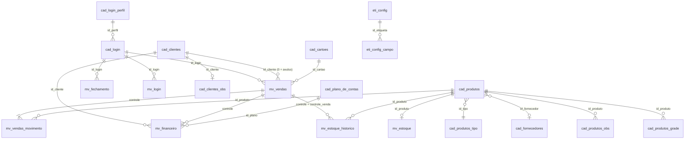

# DATABASE_MAPPING.md — Atrativa Shore

> **Etapa 1 (Diagnóstico).** Documento gerado a partir da análise do arquivo `bd.sql` enviado. Nenhuma alteração foi feita no banco, nenhum código de backend foi escrito. Todas as contagens foram calculadas carregando os INSERTs do dump em um banco temporário de análise.

## 1. Resumo executivo

O banco é o de um **sistema desktop legado de PDV/loja** (terminal, turno, caixa, carnê), ainda em uso: há vendas até **2026-08-24**. O backend NestJS vai **coexistir com esse sistema** sobre as mesmas tabelas. Isso muda várias premissas do briefing.

| # | Achado | Impacto no briefing |
|---|---|---|
| 1 | Dump de **MySQL 4.0.1-alpha**, todas as 21 tabelas **MyISAM**, **zero chaves estrangeiras** | MyISAM **não suporta transações**. A regra "venda + baixa de estoque em transação MySQL" é **impossível** sem converter as tabelas para InnoDB. **Requer sua autorização** (seção 6, P1). |
| 2 | **Não há multiempresa**: `cad_empresa` tem 1 linha e nenhuma tabela possui `id_empresa` | "Respeitar a empresa autenticada" não tem coluna onde se apoiar. O sistema é **single-tenant** (seção 6, P3). |
| 3 | Senha em **texto puro**, `varchar(6)` (`cad_login.senha`) | bcrypt exige ~60 caracteres. Alterar a coluna **quebra o login do sistema legado** se ele ainda comparar texto puro (seção 6, P2). |
| 4 | Perfis de acesso = string de 250 flags `S`/`N` sem mapa de significado | Não dá para derivar permissões por rota do banco. Só existe 1 usuário e 1 perfil (ADMINISTRADOR) (P4). |
| 5 | Vínculos entre venda/itens/financeiro/estoque feitos por **`controle` (timestamp varchar(14))**, não por `id` | Entidades TypeORM devem relacionar por `controle`. Duas vendas no mesmo segundo colidiriam (P8). |
| 6 | Valores monetários em **FLOAT** | Risco de arredondamento; cálculo no backend precisa de arredondamento controlado (P9). |
| 7 | **Codificação de caracteres mista** (CP850 + Latin-1 no mesmo arquivo) | Textos como `CARNÊ` aparecem como `CARNÒ`; `Ç` como `\x80`. Precisa de saneamento antes de usar utf8mb4 (P10). |
| 8 | Estoque: só **entradas** em `mv_estoque_historico`; saídas ficam em `mv_vendas_movimento` | Não existe uma tabela única de movimentações. "Histórico de movimentações" é uma união de duas fontes (seção 5). |
| 9 | `min_estoque` está **vazio (nulo ou 0) em todos** os produtos | "Estoque baixo" por mínimo não é possível com os dados atuais (P6). |
| 10 | Dados órfãos: 170 itens de venda e 14 saldos de estoque apontam para produtos que não existem mais | Integridade histórica; não pode ser corrigida por DELETE (P7). |

## 2. Visão geral do dump

- Origem: `MySQL dump 8.19`, host `localhost`, banco `store4`, *server version* `4.0.1-alpha-max`.
- Sintaxe incompatível com MySQL 8: `TYPE=MyISAM` (removido; hoje é `ENGINE=`), `DROP TABLE` embutido, `int(8) unsigned zerofill`, `FLOAT(M,D)` (obsoleto), `0000-00-00` como default.
- O nome do banco no dump (`store4`) difere do exemplo do briefing (`atrativaLoja`). **O nome real do schema precisa ser confirmado** para o `.env`.
- Arquivo com CRLF e ~7,8 MB, 21 tabelas.

| Tabela | Linhas | Entidade TypeORM proposta | Papel |
|---|---:|---|---|
| `cad_cartoes` | 0 | `CartaoEntity` | Cartões de crédito/débito e % de taxa sobre a venda. |
| `cad_clientes` | 321 | `ClienteEntity` | Cadastro de clientes. |
| `cad_clientes_obs` | 1 | `ClienteObsEntity` | Observações e foto do cliente (1:1 lógico). |
| `cad_empresa` | 1 | `EmpresaEntity` | Dados da empresa (existe 1 única linha). |
| `cad_fornecedores` | 2 | `FornecedorEntity` | Fornecedores. |
| `cad_login` | 1 | `UsuarioEntity` | Usuários do sistema (login/senha/perfil). |
| `cad_login_perfil` | 1 | `PerfilEntity` | Perfis de acesso (flags de menu). |
| `cad_plano_de_contas` | 9 | `PlanoContaEntity` | Plano de contas do financeiro (E=entrada. S=saída). |
| `cad_produtos` | 578 | `ProdutoEntity` | Cadastro de produtos. |
| `cad_produtos_grade` | 0 | `ProdutoGradeEntity` | Grade (variações) de produto. Vazia e sem uso (grade=0 em todos). |
| `cad_produtos_obs` | 4 | `ProdutoObsEntity` | Observações de produto. 4 linhas. 3 com lixo binário. |
| `cad_produtos_tipo` | 1 | `ProdutoTipoEntity` | Categorias de produto. |
| `eti_config` | 3 | `EtiquetaConfigEntity` | Layout de etiquetas de código de barras (impressão). |
| `eti_config_campo` | 23 | `EtiquetaConfigCampoEntity` | Campos posicionados em cada layout de etiqueta. |
| `mv_estoque` | 578 | `EstoqueEntity` | Saldo atual por produto (1 linha por produto). |
| `mv_estoque_historico` | 2.621 | `EstoqueHistoricoEntity` | Lançamentos de ENTRADA de estoque (compras/devoluções). |
| `mv_fechamento` | 1.812 | `FechamentoCaixaEntity` | Abertura/fechamento de caixa por turno e terminal. |
| `mv_financeiro` | 15.514 | `FinanceiroEntity` | Contas a receber/pagar e lançamentos de caixa (parcelas. carnês). |
| `mv_login` | 57 | `LoginSessaoEntity` | Log de entrada/saída de usuários no sistema desktop. |
| `mv_vendas` | 9.870 | `VendaEntity` | Cabeçalho da venda. |
| `mv_vendas_movimento` | 25.431 | `VendaItemEntity` | Itens da venda. |

## 3. Mapeamento tabela a tabela

Convenções: **PK** = chave primária; **UQ** = índice único; **NULL?** = aceita nulo; *FK lógica* = relacionamento inferido pelo nome e pelos dados, **sem constraint no banco**. Os nomes de tabelas e colunas serão mantidos exatamente como estão (`@Entity("cad_clientes")`, `@Column({ name: "nome_cliente" })`); apenas as propriedades TypeScript usarão camelCase.

### 3.1. `cad_cartoes` → `CartaoEntity`

Cartões de crédito/débito e % de taxa sobre a venda.

| Coluna | Tipo MySQL | NULL? | Default | Observação |
|---|---|---|---|---|
| `id` | `tinyint(3) unsigned` | não | auto_increment |  |
| `nome_cartao` | `varchar(30)` | não | '' |  |
| `porc_sobre_venda` | `decimal(10,2)` | não | '0.00' |  |

**PK:** `id` · **Índices:** UQ `cart` (nome_cartao); UQ `id` (id); KEY `id_2` (id)

### 3.2. `cad_clientes` → `ClienteEntity`

Cadastro de clientes.

| Coluna | Tipo MySQL | NULL? | Default | Observação |
|---|---|---|---|---|
| `id` | `int(8) unsigned` | não | auto_increment |  |
| `nome_cliente` | `varchar(60)` | sim | NULL |  |
| `endereco` | `varchar(50)` | sim | NULL |  |
| `bairro` | `varchar(30)` | sim | NULL |  |
| `cidade` | `varchar(30)` | sim | NULL |  |
| `uf` | `char(2)` | sim | NULL |  |
| `telefone` | `varchar(15)` | sim | NULL |  |
| `celular` | `varchar(15)` | sim | NULL |  |
| `email` | `varchar(100)` | sim | NULL |  |
| `cpf` | `varchar(18)` | sim | NULL |  |
| `cep` | `varchar(15)` | sim | NULL |  |
| `cod_barra` | `varchar(13)` | sim | NULL |  |
| `dataniver` | `date` | sim | NULL |  |
| `rg` | `varchar(16)` | sim | NULL |  |
| `inf_adicional` | `varchar(255)` | sim | NULL |  |
| `faixasalarial` | `float(10,2)` | sim | NULL |  |
| `ie` | `varchar(16)` | sim | NULL |  |

**PK:** `id` · **Índices:** UQ `id` (id); UQ `in2` (id,nome_cliente); KEY `id_2` (id)

### 3.3. `cad_clientes_obs` → `ClienteObsEntity`

Observações e foto do cliente (1:1 lógico).

| Coluna | Tipo MySQL | NULL? | Default | Observação |
|---|---|---|---|---|
| `id` | `int(10) unsigned` | não | auto_increment |  |
| `id_cliente` | `int(10) unsigned` | não | '0' |  |
| `observacoes` | `text` | sim | — |  |
| `foto` | `blob` | sim | — |  |

**PK:** `id` · **Índices:** UQ `id` (id); KEY `id_2` (id)

### 3.4. `cad_empresa` → `EmpresaEntity`

Dados da empresa (existe 1 única linha).

| Coluna | Tipo MySQL | NULL? | Default | Observação |
|---|---|---|---|---|
| `id` | `int(8) unsigned` | não | auto_increment |  |
| `nome_empresa` | `varchar(100)` | sim | NULL |  |
| `endereco` | `varchar(100)` | sim | NULL |  |
| `cidade` | `varchar(30)` | sim | NULL |  |
| `uf` | `char(2)` | sim | NULL |  |
| `cnpj` | `varchar(18)` | sim | NULL |  |
| `ie` | `varchar(16)` | sim | NULL |  |
| `telefone` | `varchar(15)` | sim | NULL |  |
| `fax` | `varchar(15)` | sim | NULL |  |
| `mensagem` | `varchar(200)` | sim | NULL |  |
| `qtd_terminal` | `int(3) unsigned zerofill` | sim | '001' | `int(3) unsigned zerofill`. |
| `chave_liberacao` | `varchar(21)` | sim | NULL |  |
| `im` | `varchar(20)` | sim | NULL |  |
| `qtd_turnos` | `char(1)` | não | '1' |  |
| `foto` | `blob` | sim | — | BLOB (vazio). |
| `max_desc` | `float` | sim | NULL |  |
| `fracionado` | `tinyint(1)` | sim | NULL |  |
| `email` | `varchar(200)` | sim | NULL |  |
| `site` | `varchar(200)` | sim | NULL |  |
| `bairro` | `varchar(200)` | sim | NULL |  |
| `cep` | `varchar(15)` | sim | NULL |  |

**PK:** `id` · **Índices:** UQ `id` (id); KEY `id_2` (id)

### 3.5. `cad_fornecedores` → `FornecedorEntity`

Fornecedores.

| Coluna | Tipo MySQL | NULL? | Default | Observação |
|---|---|---|---|---|
| `id` | `int(8) unsigned` | não | auto_increment |  |
| `nome_fornecedor` | `varchar(60)` | sim | NULL |  |
| `cnpj` | `varchar(18)` | sim | NULL |  |
| `uf` | `char(2)` | sim | NULL |  |
| `cidade` | `varchar(20)` | sim | NULL |  |
| `rua` | `varchar(50)` | sim | NULL |  |
| `contato` | `varchar(30)` | sim | NULL |  |
| `e_mail` | `varchar(100)` | sim | NULL |  |
| `telefone` | `varchar(15)` | sim | NULL |  |
| `fax` | `varchar(15)` | sim | NULL |  |
| `ie` | `varchar(16)` | sim | NULL |  |
| `cep` | `varchar(15)` | sim | NULL |  |

**PK:** `id` · **Índices:** UQ `id` (id); UQ `NewIndex` (nome_fornecedor); KEY `id_2` (id)

### 3.6. `cad_login` → `UsuarioEntity`

Usuários do sistema (login/senha/perfil).

| Coluna | Tipo MySQL | NULL? | Default | Observação |
|---|---|---|---|---|
| `id` | `int(8) unsigned` | não | auto_increment |  |
| `login` | `varchar(15)` | sim | NULL | Chave natural única (UNIQUE `in2`). |
| `senha` | `varchar(6)` | sim | NULL | **Senha em TEXTO PURO, varchar(6)**. Um hash bcrypt (60 caracteres) não cabe. |
| `id_perfil` | `int(8) unsigned` | não | '1' |  |
| `autoriza` | `char(1)` | sim | NULL | Significado não documentado (valor atual: `S`). |

**PK:** `id` · **Índices:** UQ `id` (id); UQ `in2` (login); KEY `id_2` (id)

### 3.7. `cad_login_perfil` → `PerfilEntity`

Perfis de acesso (flags de menu).

| Coluna | Tipo MySQL | NULL? | Default | Observação |
|---|---|---|---|---|
| `id_perfil` | `int(8) unsigned` | não | auto_increment |  |
| `nome_perfil` | `varchar(30)` | sim | NULL |  |
| `menu_options` | `varchar(250)` | sim | NULL | 250 caracteres `S`/`N`, um por item de menu do sistema legado. Mapa posição→menu não existe no banco. |

**PK:** `id_perfil` · **Índices:** UQ `id_perfil` (id_perfil); UQ `NewIndex` (nome_perfil); KEY `id_perfil_2` (id_perfil)

### 3.8. `cad_plano_de_contas` → `PlanoContaEntity`

Plano de contas do financeiro (E=entrada, S=saída).

| Coluna | Tipo MySQL | NULL? | Default | Observação |
|---|---|---|---|---|
| `id` | `int(8) unsigned` | não | auto_increment |  |
| `nome_plano` | `varchar(30)` | não | '' |  |
| `tipo_lancamento` | `char(1)` | não | 'E' |  |

**PK:** `id` · **Índices:** UQ `id` (id); KEY `id_2` (id)

### 3.9. `cad_produtos` → `ProdutoEntity`

Cadastro de produtos.

| Coluna | Tipo MySQL | NULL? | Default | Observação |
|---|---|---|---|---|
| `id` | `int(8) unsigned` | não | auto_increment |  |
| `nome_produto` | `varchar(60)` | sim | NULL | UNIQUE (`NewIndex`). |
| `vr_compra` | `float(10,2)` | sim | NULL |  |
| `vr_venda` | `float(10,2)` | sim | NULL | **Preço a prazo** (confirmado pela tela Produtos: "Valor à Prazo"; ex.: 18,00). |
| `modo_estoque` | `int(1) unsigned` | sim | NULL | 1 = controla estoque (576); 6 = item de serviço/recebimento de carnê, sem estoque (2). |
| `id_tipo` | `int(5) unsigned` | sim | NULL | FK lógica → `cad_produtos_tipo.id` (sem constraint). |
| `id_fornecedor` | `int(8) unsigned` | sim | NULL | FK lógica → `cad_fornecedores.id` (sem constraint). |
| `inf_adicional` | `varchar(30)` | sim | NULL |  |
| `cod_barra` | `varchar(20)` | sim | NULL | Sem índice; sem duplicidades nos dados atuais. |
| `impostos` | `float(8,2)` | sim | NULL |  |
| `unidade` | `char(3)` | sim | NULL |  |
| `min_estoque` | `float` | sim | NULL | Nulo ou 0 em TODOS os produtos: não há base para "estoque baixo" via mínimo. |
| `vr_venda_2` | `float(10,2)` | sim | NULL | **Preço à vista** (tela Produtos: "Valor à Vista"; é o valor que aparece no nome, ex.: `FRONHA IBI 14,99`). |
| `ipi` | `float` | sim | NULL |  |
| `base_icms` | `float` | sim | NULL |  |
| `inside_icms_ipi` | `int(11)` | sim | NULL |  |
| `situacao_trib` | `char(3)` | sim | NULL |  |
| `id_class_fiscal` | `int(11)` | sim | NULL |  |
| `grade` | `tinyint(1) unsigned` | não | '0' | 0 em todos os produtos. |

**PK:** `id` · **Índices:** UQ `NewIndex` (nome_produto); UQ `id` (id); KEY `id_2` (id)

### 3.10. `cad_produtos_grade` → `ProdutoGradeEntity`

Grade (variações) de produto. Vazia e sem uso (grade=0 em todos).

| Coluna | Tipo MySQL | NULL? | Default | Observação |
|---|---|---|---|---|
| `id` | `int(10) unsigned` | não | auto_increment |  |
| `id_produto` | `int(10) unsigned` | não | '0' |  |
| `descricao` | `varchar(30)` | não | '0' |  |
| `quantidade` | `float(10,3)` | sim | '0.000' |  |

**PK:** `id` · **Índices:** UQ `id` (id); KEY `id_2` (id)

### 3.11. `cad_produtos_obs` → `ProdutoObsEntity`

Observações de produto. 4 linhas, 3 com lixo binário.

| Coluna | Tipo MySQL | NULL? | Default | Observação |
|---|---|---|---|---|
| `id` | `int(10) unsigned` | não | auto_increment |  |
| `id_produto` | `int(10) unsigned` | não | '0' |  |
| `observacoes` | `text` | sim | — |  |

**PK:** `id` · **Índices:** UQ `id` (id); KEY `id_2` (id)

### 3.12. `cad_produtos_tipo` → `ProdutoTipoEntity`

Categorias de produto.

| Coluna | Tipo MySQL | NULL? | Default | Observação |
|---|---|---|---|---|
| `id` | `int(5) unsigned` | não | auto_increment |  |
| `nome_tipo` | `varchar(30)` | sim | NULL |  |

**PK:** `id` · **Índices:** UQ `NewIndex` (nome_tipo); UQ `id` (id); KEY `id_2` (id)

### 3.13. `eti_config` → `EtiquetaConfigEntity`

Layout de etiquetas de código de barras (impressão).

| Coluna | Tipo MySQL | NULL? | Default | Observação |
|---|---|---|---|---|
| `id` | `tinyint(3) unsigned` | não | auto_increment |  |
| `nome_etiqueta` | `varchar(60)` | sim | NULL |  |
| `pag_comprimento` | `float(10,2)` | sim | NULL |  |
| `pag_largura` | `float(10,2)` | sim | NULL |  |
| `qtd_colunas` | `tinyint(3) unsigned` | sim | '0' |  |
| `espaco_colunas` | `float(10,2)` | sim | NULL |  |
| `etq_comprimento` | `float(10,2)` | sim | NULL |  |
| `marg_top` | `float(10,2)` | sim | NULL |  |
| `marg_bottom` | `float(10,2)` | sim | NULL |  |
| `marg_left` | `float(10,2)` | sim | NULL |  |
| `marg_right` | `float(10,2)` | sim | NULL |  |

**PK:** `id` · **Índices:** UQ `id` (id); KEY `id_2` (id)

### 3.14. `eti_config_campo` → `EtiquetaConfigCampoEntity`

Campos posicionados em cada layout de etiqueta.

| Coluna | Tipo MySQL | NULL? | Default | Observação |
|---|---|---|---|---|
| `id` | `tinyint(3) unsigned` | não | auto_increment |  |
| `nome_demonstrativo` | `varchar(30)` | sim | NULL |  |
| `id_etiqueta` | `tinyint(3) unsigned` | sim | NULL |  |
| `id_class` | `tinyint(3) unsigned` | sim | NULL |  |
| `usar` | `tinyint(3) unsigned` | sim | NULL |  |
| `nome_campo` | `varchar(30)` | sim | NULL |  |
| `top_e` | `float(10,2)` | sim | NULL |  |
| `left_e` | `float(10,2)` | sim | NULL |  |
| `width_e` | `float(10,2)` | sim | NULL |  |
| `height_e` | `float(10,2)` | sim | NULL |  |
| `font_size_e` | `tinyint(3) unsigned` | sim | NULL |  |

**PK:** `id` · **Índices:** UQ `id` (id); KEY `id_2` (id)

### 3.15. `mv_estoque` → `EstoqueEntity`

Saldo atual por produto (1 linha por produto).

| Coluna | Tipo MySQL | NULL? | Default | Observação |
|---|---|---|---|---|
| `id` | `int(8) unsigned` | não | auto_increment |  |
| `id_produto` | `int(8) unsigned` | sim | NULL | UNIQUE (`id2`). FK lógica → `cad_produtos.id`. |
| `quantidade` | `float(10,3)` | sim | NULL | FLOAT(10,3). Saldo mantido pela aplicação (não é derivado por trigger). |
| `modo_estoque` | `int(1) unsigned` | sim | NULL |  |

**PK:** `id` · **Índices:** UQ `id` (id); UQ `id2` (id_produto); KEY `id_2` (id)

### 3.16. `mv_estoque_historico` → `EstoqueHistoricoEntity`

Lançamentos de ENTRADA de estoque (compras/devoluções).

| Coluna | Tipo MySQL | NULL? | Default | Observação |
|---|---|---|---|---|
| `id` | `int(8) unsigned` | não | auto_increment |  |
| `controle` | `varchar(14)` | sim | NULL | Timestamp `yyyymmddhhmmss` do lançamento. |
| `data_lanca` | `date` | sim | NULL |  |
| `id_produto` | `int(8) unsigned` | sim | NULL |  |
| `quantidade` | `float(10,3)` | sim | NULL | Sempre POSITIVA nos 2.621 registros: o histórico só registra entradas. |
| `numerodanota` | `varchar(15)` | sim | NULL |  |
| `terminal` | `char(2)` | sim | NULL |  |
| `vr_compra` | `float(10,2)` | sim | NULL |  |
| `controle_venda` | `varchar(14)` | sim | NULL | Preenchido em 325 linhas; só 135 apontam para venda existente. Provável devolução/troca. **Confirmar.** |
| `estornado` | `int(1) unsigned` | sim | '0' |  |
| `id_fornecedor` | `int(8) unsigned` | sim | NULL | FK lógica → `cad_fornecedores.id`. |
| `turno` | `char(1)` | sim | NULL |  |

**PK:** `id` · **Índices:** UQ `id` (id); KEY `id_2` (id)

### 3.17. `mv_fechamento` → `FechamentoCaixaEntity`

Abertura/fechamento de caixa por turno e terminal.

| Coluna | Tipo MySQL | NULL? | Default | Observação |
|---|---|---|---|---|
| `id` | `int(8) unsigned` | não | auto_increment |  |
| `hora_abertura` | `time` | sim | NULL |  |
| `hora_fechamento` | `time` | sim | NULL |  |
| `data_abertura` | `date` | sim | NULL |  |
| `data_fechamento` | `date` | sim | NULL |  |
| `vr_abertura` | `float(10,2)` | sim | NULL |  |
| `vr_fechamento` | `float(10,2)` | sim | NULL |  |
| `id_login` | `int(8) unsigned` | sim | NULL |  |
| `turno` | `char(1)` | sim | NULL |  |
| `terminal` | `char(2)` | sim | NULL |  |
| `status_caixa` | `char(1)` | sim | NULL | F=fechado (1.811), P=aberto (1). Há 1 caixa aberto em 2026-08-24. |

**PK:** `id` · **Índices:** UQ `id` (id); KEY `id_2` (id)

### 3.18. `mv_financeiro` → `FinanceiroEntity`

Contas a receber/pagar e lançamentos de caixa (parcelas, carnês).

| Coluna | Tipo MySQL | NULL? | Default | Observação |
|---|---|---|---|---|
| `id` | `int(8) unsigned` | não | auto_increment |  |
| `controle` | `varchar(14)` | sim | NULL | Liga à venda (origem `V`) ou ao carnê/compra. |
| `data_lancamento` | `date` | sim | NULL |  |
| `data_vencimento` | `date` | sim | NULL |  |
| `data_pagamento` | `date` | sim | NULL |  |
| `origem_lancamento` | `char(1)` | sim | NULL | V=venda (4.537), C=carnê (8.531), E=entrada/compra (2.435), B=7, R=4. |
| `tipo_lancamento` | `char(1)` | não | 'E' | E=entrada (receber), S=saída (pagar). |
| `parcela` | `int(3) unsigned` | não | '1' |  |
| `vr_pago` | `float(10,2)` | sim | NULL |  |
| `id_cliente` | `int(8) unsigned` | sim | NULL |  |
| `vr_desconto` | `float(10,2)` | sim | NULL |  |
| `vr_juros` | `float(10,2)` | sim | NULL |  |
| `historico` | `varchar(200)` | sim | NULL |  |
| `id_plano` | `int(5) unsigned` | sim | NULL | FK lógica → `cad_plano_de_contas.id`. |
| `vr_parcela` | `float(10,2)` | sim | NULL |  |
| `efetuado` | `char(1)` | não | 'N' | S/N: parcela quitada. |
| `documento` | `varchar(15)` | sim | NULL |  |
| `cod_carne` | `varchar(13)` | sim | NULL |  |
| `estornado` | `int(1) unsigned` | sim | '0' |  |
| `terminal` | `char(2)` | sim | NULL |  |
| `turno` | `char(1)` | sim | NULL |  |
| `data_documento` | `date` | sim | NULL |  |
| `data_credito` | `date` | sim | NULL |  |
| `nosso_numero` | `varchar(10)` | sim | NULL |  |
| `vr_despesa_cobranca` | `decimal(10,2)` | sim | NULL |  |
| `vr_abatimento` | `decimal(10,2)` | sim | NULL |  |
| `id_cedente` | `int(11)` | sim | NULL |  |
| `vr_recebido` | `decimal(10,2)` | sim | NULL |  |

**PK:** `id` · **Índices:** UQ `id` (id); KEY `id_2` (id)

### 3.19. `mv_login` → `LoginSessaoEntity`

Log de entrada/saída de usuários no sistema desktop.

| Coluna | Tipo MySQL | NULL? | Default | Observação |
|---|---|---|---|---|
| `id` | `int(10) unsigned` | não | auto_increment |  |
| `data_entrada` | `date` | não | '0000-00-00' | Default `0000-00-00` (inválido em MySQL 8 com `sql_mode` estrito). |
| `data_saida` | `date` | sim | NULL |  |
| `hora_entrada` | `time` | não | '00:00:00' |  |
| `hora_saida` | `time` | sim | NULL |  |
| `id_login` | `int(10) unsigned` | não | '0' |  |
| `ip_maquina` | `varchar(15)` | não | '' |  |
| `nome_maquina` | `varchar(50)` | não | '' |  |
| `status_login` | `tinyint(1) unsigned` | não | '0' |  |
| `terminal` | `char(2)` | não | '01' |  |

**PK:** `id` · **Índices:** UQ `id` (id); KEY `id_2` (id)

### 3.20. `mv_vendas` → `VendaEntity`

Cabeçalho da venda.

| Coluna | Tipo MySQL | NULL? | Default | Observação |
|---|---|---|---|---|
| `id` | `int(8) unsigned` | não | auto_increment |  |
| `controle` | `varchar(14)` | sim | NULL | Chave natural: timestamp `yyyymmddhhmmss` (14 caracteres). UNIQUE (`unx_controle`). É a ligação real com itens, financeiro e histórico. |
| `data_venda` | `date` | sim | NULL |  |
| `id_cliente` | `int(8) unsigned` | sim | '0' | 0 = consumidor não identificado (6.559 vendas). Não existe cliente de id 0. |
| `id_login` | `int(3) unsigned` | sim | NULL |  |
| `vr_total` | `float(10,2)` | sim | NULL | **Valor líquido pago** = soma de `vr_dinheiro+vr_cheque+vr_cartao+vr_carne+vr_ticket` em **100%** das vendas. Também = soma de `mv_vendas_movimento.vr_total` em 98,6%; a diferença são trocas (`modo_venda=4`). |
| `vr_adicional` | `float(10,2)` | sim | NULL | **Desconto (informativo)**: idêntico a `mv_financeiro.vr_desconto` em 4.494 de 4.494 vendas com lançamento. Os itens já são gravados com o valor líquido. |
| `parcelas` | `int(3) unsigned` | sim | NULL |  |
| `estornado` | `int(1) unsigned` | sim | '0' | 0/1. Estorno é lógico (flag + `estornado_data`), nunca DELETE. |
| `estornado_data` | `date` | sim | NULL |  |
| `vr_dinheiro` | `float(10,2)` | sim | NULL |  |
| `vr_cheque` | `float(10,2)` | sim | NULL |  |
| `vr_cartao` | `float(10,2)` | sim | NULL |  |
| `vr_carne` | `float(10,2)` | sim | NULL |  |
| `vr_ticket` | `float(10,2)` | sim | NULL |  |
| `terminal` | `char(2)` | sim | NULL |  |
| `turno` | `char(1)` | sim | NULL |  |
| `id_cartao` | `tinyint(3) unsigned` | sim | '0' | FK lógica → `cad_cartoes.id` (tabela vazia). |

**PK:** `id` · **Índices:** UQ `unx_controle` (controle); UQ `id` (id); KEY `id_2` (id)

### 3.21. `mv_vendas_movimento` → `VendaItemEntity`

Itens da venda.

| Coluna | Tipo MySQL | NULL? | Default | Observação |
|---|---|---|---|---|
| `id` | `int(10) unsigned` | não | auto_increment |  |
| `controle` | `varchar(14)` | sim | NULL | Liga ao cabeçalho por `mv_vendas.controle` (não por id). |
| `data_venda` | `date` | sim | NULL |  |
| `id_login` | `int(8) unsigned` | sim | NULL |  |
| `id_produto` | `int(8) unsigned` | sim | NULL | FK lógica → `cad_produtos.id`. **170 itens apontam para produtos inexistentes.** |
| `valor` | `float(10,2)` | sim | NULL |  |
| `quant` | `float(10,3)` | sim | NULL | FLOAT(10,3): suporta venda fracionada (metro/peso). |
| `vr_total` | `float(10,2)` | sim | NULL |  |
| `modo_venda` | `int(1) unsigned` | sim | NULL | 1 = produto vendido (17.335); 6 = recebimento de carnê (7.955); **4 = item devolvido em troca** (139; o valor é abatido do total, ex.: 36+18+24 − 63 = 15 pago); 3 = 2 itens (indefinido). |
| `id_cliente` | `int(8) unsigned` | sim | NULL |  |
| `estornado` | `int(1) unsigned` | sim | '0' |  |
| `terminal` | `char(2)` | sim | NULL |  |
| `turno` | `char(1)` | sim | NULL |  |
| `modo_lancamento` | `tinyint(1) unsigned` | não | '0' | 0 / 2 / 3. Significado não documentado. **Confirmar.** |
| `id_grade` | `int(10) unsigned` | não | '0' |  |

**PK:** `id` · **Índices:** UQ `id` (id); KEY `id_2` (id)

> Observação geral de índices: em quase todas as tabelas existem `UNIQUE (id)` e `KEY (id)` **duplicados da PK**, sem utilidade. Não serão replicados nas entidades.

> `cad_clientes` tem `UNIQUE (id, nome_cliente)`, que **não impede nome duplicado** (e CPF/código de barras não têm índice). `cad_produtos` e `cad_fornecedores` têm `nome` UNIQUE.

## 4. Relacionamentos (todos lógicos — não há FKs)

Verificações feitas nos dados (refeitas com `NOT EXISTS`; ver errata abaixo): venda→cliente (0 órfãos para id>0), venda→login (0), financeiro→cliente (0), produto→tipo (0), produto→fornecedor (0), parcelas V/C→venda (0).

- **Itens sem cabeçalho em `mv_vendas`: 7.957.** Não é inconsistência: 7.955 são **recebimentos de carnê** (`modo_venda = 6`), que o desktop grava só em `mv_vendas_movimento`; os outros 2 são `modo_venda = 3`.
- 1 venda sem itens (id 3168, a mesma sem controle e sem data).
- **2.210 vendas sem lançamento financeiro**: 2.172 são vendas só no cartão — o desktop não lança cartão em `mv_financeiro`.
- **Toda nota de entrada tem conta a pagar** (2.251 de 2.251): o desktop sempre lança a compra em `mv_financeiro` (origem E).
- Trocas: 135 de 136 vendas com troca têm o item devolvido lançado em `mv_estoque_historico` com `numerodanota = 'V' + controle[3:]`.

> **Errata (04/11/2026):** a primeira versão deste documento dizia "item→venda: 0 órfãos" e "toda venda tem item". Essas checagens usavam `NOT IN` sobre colunas com valores nulos, o que sempre resulta em zero. Os números acima foram recalculados com `NOT EXISTS`.

**Os únicos vínculos realmente quebrados são os que envolvem produtos** (seção 6, P7).

## 5. Como os domínios do briefing mapeiam para o banco

| Domínio do briefing | Tabelas reais | Observações |
|---|---|---|
| Usuários / auth | `cad_login`, `cad_login_perfil`, (`mv_login` = log) | Login por `login` (sem e-mail). 1 usuário. |
| Empresas | `cad_empresa` | 1 linha. Não há vínculo de empresa com nenhuma outra tabela. |
| Clientes | `cad_clientes`, `cad_clientes_obs` | 321 clientes; 27 sem CPF; nenhum com e-mail; CPF sem máscara padronizada (tamanhos de 5 a 18). |
| Produtos | `cad_produtos`, `_tipo`, `_obs`, `_grade`, `cad_fornecedores` | Não existe flag ativo/inativo. 14 produtos "desativados" seguem o padrão: sem preço, `vr_compra=0,01`, sem linha em `mv_estoque`. **Inferência, a confirmar.** |
| Vendas | `mv_vendas` + `mv_vendas_movimento` (+ `mv_financeiro` para pagamento) | Pagamento está em colunas (`vr_dinheiro`, `vr_cartao`, `vr_carne`, `vr_cheque`, `vr_ticket`), não em tabela própria. |
| Estoque | `mv_estoque` (saldo), `mv_estoque_historico` (entradas) | Saídas = itens de venda com `modo_venda=1`. |
| Movimentações | união de `mv_estoque_historico` (entradas) e `mv_vendas_movimento` (saídas) | Conferência (entradas − vendas não estornadas = saldo): **apenas 3 divergências** entre os produtos controlados que têm saldo cadastrado (ids 93, 171, 396; os dois últimos têm itens `modo_venda=3`). |
| Relatórios | `mv_vendas`, `mv_vendas_movimento`, `mv_estoque`, `mv_financeiro`, `mv_fechamento` | Fechamento de caixa e financeiro permitem relatórios que o briefing não pediu (opcionais). |
| Fora do escopo do briefing | `cad_cartoes`, `cad_plano_de_contas`, `eti_*`, `mv_fechamento`, `mv_login` | Preservados; só expostos se você quiser. |

### Volumes úteis

- Vendas: **9.870** (150 estornadas), de 2020-09-16 a 2026-08-24; ≈ R$ 769 mil somando `vr_total` (inclui estornadas).
- Itens de venda: **25.431** (316 estornados). Financeiro: 15.514. Produtos: 578. Clientes: 321.
- Vendas por ano (não estornadas): 2020: 264 · 2021: 1.161 · 2022: 1.673 · 2023: 1.841 · 2024: 1.802 · 2025: 1.793 · 2026: 1.185.

## 6. Inconsistências, riscos e decisões necessárias

Cada item traz evidência, proposta e se **precisa de autorização** antes de qualquer mudança.

| ID | Gravidade | Problema | Autorização? |
|---|---|---|---|
| P1 | CRÍTICO | Tabelas MyISAM: sem transações e sem FKs | SIM |
| P2 | CRÍTICO | Senha em texto puro e coluna curta | SIM |
| P3 | ALTO | Sem multiempresa | SIM |
| P4 | ALTO | Controle de acesso sem mapa | SIM (informação) |
| P5 | ALTO | Semântica dos totais da venda | SIM (informação) |
| P6 | MÉDIO | Estoque baixo sem mínimo | não |
| P7 | MÉDIO | Dados órfãos (produtos excluídos sem cascata) | não |
| P8 | MÉDIO | Chave `controle` como timestamp | não |
| P9 | MÉDIO | Dinheiro em FLOAT | só se quiser mudar tipo |
| P10 | MÉDIO | Codificação mista | SIM (informação: charset real) |
| P11 | BAIXO | Cadastro de clientes com qualidade baixa | não |
| P12 | BAIXO | Datas e defaults inválidos | não |
| P13 | INFO | Sistema legado em uso concorrente | não |

### P1 — Tabelas MyISAM: sem transações e sem FKs (CRÍTICO)

- **Evidência:** Todas as 21 tabelas usam `TYPE=MyISAM` e não há nenhuma FOREIGN KEY. `START TRANSACTION/ROLLBACK` são ignorados por MyISAM: uma falha no meio da venda deixaria venda gravada sem baixa de estoque.
- **Proposta:** Converter apenas as tabelas envolvidas na venda (`mv_vendas`, `mv_vendas_movimento`, `mv_estoque`, `mv_estoque_historico`, `mv_financeiro`, `cad_produtos`) para **InnoDB** via migration reversível (`ALTER TABLE … ENGINE=InnoDB`), após backup. Não adicionar FKs nesta fase (os dados órfãos de P7 impediriam). Alternativa sem converter: não há como cumprir a regra de transação — eu não recomendo.
- **Precisa de autorização/informação sua:** SIM

### P2 — Senha em texto puro e coluna curta (CRÍTICO)

- **Evidência:** `cad_login.senha` é `varchar(6)` com valor `202020`. O sistema desktop provavelmente lê essa coluna diretamente.
- **Proposta:** **Opção A (recomendada):** nova tabela `api_credencial (id_login, senha_hash, atualizado_em)` — não toca na tabela legada nem quebra o desktop; no primeiro login válido o backend grava o hash bcrypt. **Opção B:** `ALTER` para `varchar(60)` e hashear — protege melhor, mas exige que o sistema legado seja migrado junto. Em qualquer caso o backend nunca devolve senha.
- **Precisa de autorização/informação sua:** SIM

### P3 — Sem multiempresa (ALTO)

- **Evidência:** `cad_empresa` tem 1 linha (`ATRATIVA CAMA MESA E BANHO`). Nenhuma tabela tem `id_empresa`.
- **Proposta:** Tratar como **single-tenant**: o "contexto da empresa" é a empresa id=1. Não inventar `id_empresa`. O módulo Empresa terá GET/PATCH da empresa existente; POST (cadastrar nova) e DELETE seriam inconsistentes com o modelo — sugiro **não expor** ou limitar a administradores.
- **Precisa de autorização/informação sua:** SIM

### P4 — Controle de acesso sem mapa (ALTO)

- **Evidência:** `menu_options` é uma string de 250 `S`/`N` (todos `S` no ADMINISTRADOR). Não há tabela que diga o que cada posição significa.
- **Proposta:** Fase 1: JWT + papel derivado do `id_perfil`; RBAC fino só se você fornecer o mapa posição→funcionalidade do sistema legado. Enquanto isso, rotas protegidas por autenticação e por `autoriza = 'S'`.
- **Precisa de autorização/informação sua:** SIM (informação)

### P5 — Semântica dos totais da venda (ALTO)

- **Evidência:** `vr_total` é 0 quando o pagamento é carnê; `vr_adicional` parece desconto; em 139 vendas (todas com itens `modo_venda=4`) não há valor em nenhuma forma de pagamento. Soma de itens ≠ soma das formas de pagamento em 139 vendas; ≠ `vr_total` na maioria (por causa de desconto/carnê).
- **Proposta:** Antes de implementar `POST /vendas`, preciso que você confirme: (a) `vr_adicional` = desconto? (b) `vr_total` = valor pago à vista/líquido? (c) o que são `modo_venda` 3 e 4 e `modo_lancamento` 2 e 3? (d) a venda deve gerar lançamento em `mv_financeiro` (o sistema legado gera; 2.210 vendas não têm lançamento)? (e) carnê/parcelas deve ser suportado agora?
- **Precisa de autorização/informação sua:** SIM (informação)

### P6 — Estoque baixo sem mínimo (MÉDIO)

- **Evidência:** `cad_produtos.min_estoque` é nulo ou 0 em 578 de 578 produtos.
- **Proposta:** Endpoint de estoque baixo recebe o **limite por parâmetro** (`?limite=5`, padrão configurável) e usa `min_estoque` quando existir. Não inventar coluna.
- **Precisa de autorização/informação sua:** não

### P7 — Dados órfãos (produtos excluídos sem cascata) (MÉDIO)

- **Evidência:** 170 itens de venda → produtos inexistentes (ids 125, 349, 207, 350, 131, 124, 151, 200…); 14 linhas de `mv_estoque` e 44 de `mv_estoque_historico` com `id_produto` inexistente; 14 produtos existentes sem linha em `mv_estoque`.
- **Proposta:** Não apagar. Relatórios fazem `LEFT JOIN` e exibem "Produto removido (#id)". Vendas/estoque **nunca** referenciam produto inexistente (validado no service). Sem criar FK. Se quiser, proponho um script de auditoria só-leitura.
- **Precisa de autorização/informação sua:** não

### P8 — Chave `controle` como timestamp (MÉDIO)

- **Evidência:** `controle varchar(14)` (`yyyymmddhhmmss`) liga venda, itens, financeiro e estoque. É UNIQUE só em `mv_vendas`. 1 venda (id 3168) tem `controle` nulo, data `0000-00-00` e terminal nulo. 39 grupos de itens idênticos (mesmo controle/produto/valor/qtd) — podem ser legítimos.
- **Proposta:** Backend gera `controle` no mesmo formato, com **retry em caso de colisão** (UNIQUE já existe), e relaciona por `controle`. Registro 3168 fica intocado, tratado como inválido nos relatórios (excluído por `controle IS NOT NULL`).
- **Precisa de autorização/informação sua:** não

### P9 — Dinheiro em FLOAT (MÉDIO)

- **Evidência:** Todas as colunas de valor são `FLOAT(10,2)`; quantidades `FLOAT(10,3)` (ex.: 43.760,398 num rolo).
- **Proposta:** Cálculos no backend em **centavos inteiros** com arredondamento half-up e conversão para 2 casas na gravação; comparações com tolerância. Mudar o tipo para DECIMAL é opcional e exige autorização.
- **Precisa de autorização/informação sua:** só se quiser mudar tipo

### P10 — Codificação mista (MÉDIO)

- **Evidência:** Bytes ≥ 0x80 aparecem em CP850 (`AVARÉ`, `\x80`=Ç) e Latin-1 (`CARNÊ` vs `CARNÒ`) no mesmo arquivo. `cad_produtos_obs` contém lixo binário (`ÌÌÌÌ…`).
- **Proposta:** Definir o charset real do banco em produção (`SHOW CREATE TABLE`) antes de conectar. Conexão TypeORM com `charset` explícito; saneamento de textos só por migration autorizada.
- **Precisa de autorização/informação sua:** SIM (informação: charset real)

### P11 — Cadastro de clientes com qualidade baixa (BAIXO)

- **Evidência:** 27 sem CPF; CPF com 5 a 18 caracteres (sem padrão); nenhum e-mail preenchido; CPF/código de barras sem índice.
- **Proposta:** Validação de CPF (dígitos verificadores) só em **novos** cadastros; busca por CPF normaliza removendo máscara; bloqueio de duplicidade por CPF no service (não há UNIQUE no banco). Dados antigos não são alterados.
- **Precisa de autorização/informação sua:** não

### P12 — Datas e defaults inválidos (BAIXO)

- **Evidência:** `mv_login.data_entrada default 0000-00-00`; `mv_vendas` id 3168 com data zerada. MySQL 8 em modo estrito rejeita esses valores.
- **Proposta:** Conexão sem alterar `sql_mode` global; entidades não gravam datas zeradas. Tratar `0000-00-00` como nulo na leitura.
- **Precisa de autorização/informação sua:** não

### P13 — Sistema legado em uso concorrente (INFO)

- **Evidência:** Último caixa aberto (`mv_fechamento` id 1812, status `P`) em 2026-08-24.
- **Proposta:** Baixa de estoque com `UPDATE mv_estoque SET quantidade = quantidade - ? WHERE id_produto = ? AND quantidade >= ?` (atômico) e `SELECT … FOR UPDATE` após P1, para não conflitar com o desktop.
- **Precisa de autorização/informação sua:** não

## 6.1. Atualização após leitura do frontend e nova análise (04/11/2026)

- **P5 resolvido em parte:** `vr_venda` = a prazo, `vr_venda_2` = à vista, `vr_adicional` = desconto, `vr_total` = soma das formas de pagamento, `modo_venda=4` = troca. Ainda indefinidos: `modo_lancamento` (0/2/3) e `modo_venda=3` (2 itens).
- **Novo — Pix sem coluna:** o frontend oferece Dinheiro, **Pix**, Cartão e Carnê; o banco só tem `vr_dinheiro`, `vr_cheque`, `vr_cartao`, `vr_carne`, `vr_ticket`.
- **Novo — Acréscimo sem coluna:** a tela de vendas tem desconto e acréscimo; o banco só tem `vr_adicional` (desconto).
- **Novo — carnê:** venda no carnê gera N parcelas em `mv_financeiro` (origem `C`, `cod_carne` de 13 dígitos, `efetuado='N'`); a baixa grava `efetuado='S'`, `data_pagamento`, `vr_pago` e um item `modo_venda=6`.

## 7. O que o briefing pede e o banco não suporta (sem inventar estrutura)

| Pedido | Situação | Como será tratado |
|---|---|---|
| Contexto da empresa autenticada nos relatórios | Sem `id_empresa` | Relatórios globais da única empresa (P3). |
| Excluir empresa / cliente / produto "quando permitido pelo banco" | O banco não tem FKs, então **nunca bloqueia** | O service bloqueia por regra: cliente com vendas/financeiro, produto com vendas/estoque → **409 Conflict**. |
| Estoque baixo | Sem `min_estoque` (P6) | Limite por parâmetro. |
| Histórico de movimentações | Sem tabela única de movimentações | União entrada (`mv_estoque_historico`) + saída (`mv_vendas_movimento`), com campo `tipo` calculado. |
| Registrar saída de estoque manual | `mv_estoque_historico` só tem entradas (quantidade sempre positiva) | Saída manual exigiria decisão: usar quantidade negativa ou nova tabela. **Pergunta P14.** |
| Entrada de estoque + financeiro | O legado gera linha em `mv_financeiro` (origem `E`, plano 2) ao lançar nota | Confirmar se o backend deve replicar (P15). |
| Login por e-mail | Só existe `login` | Login por `login` + `senha`. |
| Faturamento / vendas por cliente / mais vendidos | Possível | Excluindo `estornado=1` e `controle` nulo; ignorando `modo_venda=6` (recebimento de carnê não é venda de mercadoria). |

## 8. Perguntas pendentes (para liberar a Etapa 2)

- **P1:** Autoriza converter para InnoDB as tabelas de venda/estoque/financeiro (com backup prévio)?
- **P2:** Senha: Opção A (tabela nova `api_credencial`, não mexe no legado) ou B (alterar `cad_login.senha`)?
- **P3:** Confirma **single-tenant** (empresa id=1) e que cadastro/exclusão de empresa não devem ser expostos?
- **P4:** Existe o mapa das 250 posições de `menu_options`? Senão, só autenticação + `autoriza`.
- **P5:** Confirma a semântica de `vr_total`, `vr_adicional`, `modo_venda` (1/3/4/6), `modo_lancamento` (0/2/3) e se a venda deve gravar `mv_financeiro`?
- **P10:** Qual o charset real do banco em produção (`SHOW CREATE TABLE`)? E o nome do schema (`store4` ou `atrativaLoja`)?
- **P14:** Saída manual de estoque: quantidade negativa em `mv_estoque_historico` ou tabela nova?
- **P15:** Entrada de estoque deve gerar a conta a pagar em `mv_financeiro`, como o sistema legado?
- **P16:** O sistema desktop continuará em uso junto com a API? (define o nível de cuidado com concorrência e convenções do legado).
- **P17:** O frontend (pasta) ainda não foi enviado: preciso dele para alinhar campos e formato das respostas.

## 9. Situação

As perguntas foram respondidas e as decisões estão registradas em `PLANEJAMENTO.md` (seção 11). A API foi implementada seguindo este mapeamento.

## 9.1. Próximo passo (histórico)

Com as respostas acima, entrego a **Etapa 2 (Planejamento)**: módulos, entidades, DTOs, endpoints, plano das migrations e estratégia de testes. Só depois começa a implementação. Nenhuma migration destrutiva será criada sem sua aprovação explícita.
